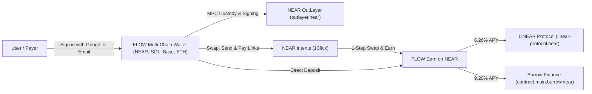

<p align="center">
  
</p>

# FLOW

**Pay with what you hold. Receive what you want. Earn native yield on NEAR.**

FLOW is a chain-abstracted multi-chain wallet, payments, and DeFi yield platform built on **NEAR OutLayer**, **NEAR Intents (1Click)**, and **NEAR DeFi**. Users sign in with Google or an email code, get a unified wallet across **NEAR**, **Solana**, **Base**, and **Ethereum**, and can send, convert, get paid across 39+ chains, and **earn up to 9.2% APY on NEAR**—all from one interface.

- **Live Application:** [https://flow.devhub.forum](https://flow.devhub.forum)
- **Repository:** [https://github.com/OpeyemiMoses/Flow](https://github.com/OpeyemiMoses/Flow)
- **X (Twitter):** [@use_flowapp](https://x.com/use_flowapp)

---

## Judges Guide

### Project Summary

- **What FLOW does:** Gives every user a single multi-chain wallet (`NEAR`, `Solana`, `Base`, `Ethereum`) where senders pay with whatever asset and chain they hold, recipients receive the exact asset and chain they want, and idle balances earn real yield on NEAR Protocol.
- **Problem it solves:** Crypto payments and DeFi yield are fragmented across incompatible wallets, gas tokens, and bridges. Getting paid in NEAR when your client holds SOL on Solana—or moving idle USDC/SOL into NEAR staking and lending—takes multiple apps and manual bridging.
- **How NEAR powers FLOW:**
  1. **NEAR OutLayer (`outlayer.near`):** Policy-governed MPC wallet custody and transaction signing across NEAR, Solana, Ethereum, and Base without seed phrases.
  2. **NEAR Intents (1Click):** Instant cross-chain quoting, swaps, and payment link settlement across 230+ tokens and 39+ blockchains.
  3. **FLOW Earn on NEAR (`LiNEAR` & `Burrow`):** Direct in-wallet liquid staking (`6.26% APY`) and DeFi supply yield (`9.20% APY`) on NEAR Protocol, with 1-step **Swap & Earn** from any chain.

### How to Evaluate (Live on Mainnet)

1. **Sign In & Auto-Provisioning:** Open [https://flow.devhub.forum/sign-in](https://flow.devhub.forum/sign-in) and continue with **Google** or an **email code**. FLOW automatically provisions your multi-chain wallet across NEAR, Solana, Base, and Ethereum.
2. **FLOW Earn on NEAR (`Earn` Tab):** Click **Earn** in the navigation bar:
   - Stake native NEAR with **LiNEAR Protocol** (`6.26% variable APY`) or supply to **Burrow Finance** (`9.20% variable APY`).
   - Hold `USDC` or `SOL` on another chain? Click **Swap now →** to convert any asset into native `NEAR` in one step via NEAR Intents and deploy directly into Earn.
3. **Cross-Chain Payment Links (`Request` Tab → `/pay/[id]`):** Create a shareable payment link requesting your preferred token (e.g., `NEAR` on NEAR Protocol). Any sender can open the link in their browser—no FLOW account required—and pay with what they hold (e.g., `SOL` on Solana or `USDC` on Base).
4. **Send, Convert & Add Money:** Swap between assets with live quotes as you type, or receive funds directly to your permanent multi-chain addresses.
5. **FLOW AI Assistant:** Open the AI assistant in the top bar to ask questions about your balances, recent settlements, or yield routes.

### Onchain Verification

| Network | Protocol / Contract | Role in FLOW |
| :--- | :--- | :--- |
| **NEAR Mainnet** | [`outlayer.near`](https://nearblocks.io/address/outlayer.near) | OutLayer MPC wallet custody & on-chain policy sponsorship |
| **NEAR Mainnet** | [`linear-protocol.near`](https://nearblocks.io/address/linear-protocol.near) | FLOW Earn — Native NEAR liquid staking (live on-chain APY via `ft_price`) |
| **NEAR Mainnet** | [`contract.main.burrow.near`](https://nearblocks.io/address/contract.main.burrow.near) | FLOW Earn — NEAR DeFi money-market yield (live on-chain APR via `get_asset`) |
| **Multi-Chain** | NEAR Intents (1Click API) | Cross-chain swaps, deposits, and payment link settlement across NEAR, Solana, Base & Ethereum |

---

## About FLOW

**FLOW** is a chain-abstracted multi-chain money app built for everyday people, freelancers, and global teams. It combines the simplicity of a modern neobank with the openness of on-chain rails—letting anyone hold, send, convert, request, and earn yield across **NEAR**, **Solana**, **Base**, and **Ethereum** from a single account, without managing seed phrases, browser extensions, or bridging workflows.

### What We Built

- **Unified Multi-Chain Account:** Passwordless Google or email sign-in automatically provisions permanent mainnet addresses across NEAR, Solana, Base, and Ethereum, backed by **NEAR OutLayer** MPC custody and on-chain security policies.
- **Cross-Chain Payments & Request Links (`/pay/[id]`):** Create shareable payment links or invoices specifying the exact asset and chain you want to receive. Payers can settle from any of 230+ supported tokens across 39+ blockchains—no FLOW account required—via **NEAR Intents (1Click)**.
- **Live Convert, Send & Cross-Chain Add Money:** Move value across chains or send to external wallets and `@handle` **Flow IDs** with real-time quotes, live step-by-step transaction trackers that survive page reloads, and built-in gas reserve protection.
- **Native NEAR DeFi Yield (`FLOW Earn`):** Stake `NEAR` with **LiNEAR Protocol** or supply `USDC` on NEAR Mainnet to **Burrow Finance** with live on-chain APY/APR reads, real-time position tracking, 1-step **Swap & Earn** from other chains, and flexible instant or standard withdrawals.
- **Personal & Business Workspaces:** Separate personal balances from team/business treasuries, track monthly inflows and outflows in **Cashflow Insights**, receive real-time settlement notifications, and query your portfolio or routes with the **FLOW AI Assistant**.

### Why We Built It

Using crypto for real payments and savings is still unnecessarily fragmented:
- A client wants to pay in `USDC` on Base or `SOL` on Solana, while you want to hold `NEAR` or `USDC` on NEAR.
- Earning yield requires finding a bridge, holding the right gas token on the destination chain, and navigating separate DeFi dashboards.
- Most wallets force everyday users to juggle seed phrases, RPC errors, and raw transaction hashes just to complete a routine transfer.

We built **FLOW** so users only think about **who** they are paying, **what** they want to hold, and **how** their money is growing—while NEAR OutLayer and NEAR Intents handle custody, routing, and cross-chain settlement invisibly underneath.

### Who It Is For

- **Everyday Crypto Users:** Anyone who wants one clean wallet for NEAR, Solana, Base, and Ethereum with Google/email login and zero seed-phrase anxiety.
- **Freelancers, Creators & Global Contractors:** Professionals who send payment links to clients worldwide and want to receive their preferred token regardless of which chain the client pays from.
- **Teams & Businesses:** Organizations managing shared treasury accounts, outgoing transfers, and monthly cashflow reporting across chains.
- **DeFi Savers:** Holders with idle `SOL`, `ETH`, or `USDC` on other networks who want to swap into NEAR and earn native staking or lending yield in one place.

### Benefits

- **Pay With What You Hold, Receive What You Want:** Eliminates manual bridging and multi-wallet juggling for both senders and recipients.
- **No Seed Phrases, Policy-Protected Custody:** Accounts are provisioned and governed by NEAR OutLayer MPC policies rather than fragile local private keys.
- **Transparent, Real-Time Execution:** Every send, swap, deposit, and Earn action is backed by live mainnet RPC state and tracked end-to-end with clear status steps and truthful error messages.
- **Productive Idle Balances:** Turn received payments directly into native NEAR yield through LiNEAR and Burrow without leaving the app.

---

## Architecture & Production Infrastructure

FLOW runs a real, mainnet-connected multi-service architecture backed by PostgreSQL, Prisma, and live blockchain RPCs—not simulated balances or mock callbacks:

- **NEAR OutLayer Custody & Policy Engine:** Multi-chain MPC wallet provisioning (`NEAR`, `Solana`, `Base`, `Ethereum`), encrypted and signed custody policies (`/wallet/v1/policy`, `/wallet/v1/encrypt-policy`, `/wallet/v1/sign-policy`), and sponsored NEAR account/policy setup (`near-policy-sponsor.ts`).
- **NEAR Intents (1Click SDK):** Uses `@defuse-protocol/one-click-sdk-typescript` for real-time token discovery across 39+ chains, live route quoting, cross-chain deposit address generation, and settlement status tracking.
- **Native NEAR DeFi Execution:** Direct NEAR Mainnet RPC state queries and contract execution against **LiNEAR** (`linear-protocol.near`) and **Burrow** (`contract.main.burrow.near`), including storage deposit checks, gas reserve enforcement, and instant or delayed unstaking.
- **Four Dedicated Background Workers:**
  - `worker:custody` — Asynchronous OutLayer wallet provisioning, policy signing, and custody state machine recovery.
  - `worker:payments` — Outgoing transfer, swap, and Earn execution with idempotency keys.
  - `worker:monitoring` — Cross-chain 1Click settlement observation and payment link monitoring.
  - `worker:indexer` — Multi-chain RPC balance reconciliation and activity indexing.
- **On-Chain Verification & Security:** Server-side transaction verification across NEAR, EVM, and Solana RPCs (`on-chain-verifier.ts`), strict Zod request validation, Prisma schema migrations with least-privilege DB role discipline, and crash-recovery state machines.

---

## Key Features

- **FLOW Earn on NEAR (`LiNEAR` & `Burrow Finance`):**
  - **Native Liquid Staking:** Stake NEAR into **LiNEAR Protocol** (`6.26% variable APY`) with auto-compounding validator rewards.
  - **DeFi Money Market Yield:** Supply USDC on NEAR Mainnet to **Burrow Finance** (`9.20% variable APY` including NEAR rewards).
  - **1-Step Swap & Earn via NEAR Intents:** Convert idle `SOL`, `USDC`, or `ETH` from other chains directly into native `NEAR` and start earning in a single workflow.
  - **Live Yield & Flexible Withdrawals:** Preview projected annual returns before depositing, track live on-chain positions, and withdraw anytime via **Instant Unstake** or **Standard (~48h)**.
- **Cross-Chain Payment Links (`/pay/[id]`):** Request payment in the exact token and network you want; your payer settles from any of 230+ supported tokens across 39+ chains without needing a FLOW account, complete with a live settlement tracker.
- **One Wallet, Four Mainnets:** A single Google or passwordless email login provisions permanent addresses across **NEAR**, **Solana**, **Base**, and **Ethereum** secured by NEAR OutLayer MPC custody.
- **Personal & Business Workspaces + Flow ID:** Switch between personal and business accounts, claim a `@handle` Flow ID for instant P2P transfers, and manage workspace preferences.
- **Live Convert, Send & Cross-Chain Add Money:** Swap between assets or send across chains with instant NEAR Intents quotes, live step-by-step transaction trackers that persist across page reloads, and built-in gas/balance safety checks.
- **Cashflow Insights, Notifications & Docs:** Real DB-backed monthly inflow/outflow insights, real-time activity notifications, and built-in Docs, FAQ, and Whitepaper pages.
- **Account-Aware FLOW AI Assistant:** Built-in assistant that reads your live portfolio, recent settlements, and real-time 1Click quotes to explain routes, draft payment links, and preview swaps or sends.

---

## How It Works



1. **Instant Wallet Setup:** Sign in with Google or an email code. FLOW provisions your multi-chain wallet via **NEAR OutLayer** and sponsors your on-chain wallet security policy on NEAR Mainnet.
2. **Pay or Get Paid Across Chains:** Create a payment link or initiate a swap/transfer. **NEAR Intents (1Click)** quotes the route in real time and settles the destination asset directly into the recipient's wallet.
3. **Swap & Earn on NEAR:** Convert idle assets from Solana, Base, or Ethereum into native NEAR via NEAR Intents and deploy into **LiNEAR Protocol** or **Burrow Finance** to earn passive yield.

---

## Screenshots and Product Walkthrough

<p align="center">
  
  <br />
  <em>FLOW multi-chain wallet interface across mobile and desktop</em>
</p>

<p align="center">
  
  <br />
  <em>One-click Google sign-in and passwordless email onboarding</em>
</p>

<p align="center">
  
  <br />
  <em>Shareable payment links with cross-chain settlement</em>
</p>

---

## Running Locally

```bash
git clone https://github.com/OpeyemiMoses/Flow.git
cd Flow
npm ci
(umask 077; cp -n .env.example .env)
npm run dev
```

### Testing & Verification

The `test/` directory includes 35+ automated test suites covering custody crash recovery, provisioning state machines, on-chain verification, financial authorization, 1Click quoting, and security integration:

```bash
npm test            # Unit test suite
npm run test:db     # Database integration tests
npm run test:security
```

---

## Contact and Links

- **Live App:** [https://flow.devhub.forum](https://flow.devhub.forum)
- **X (Twitter):** [https://x.com/use_flowapp](https://x.com/use_flowapp)
- **GitHub:** [https://github.com/OpeyemiMoses/Flow](https://github.com/OpeyemiMoses/Flow)
