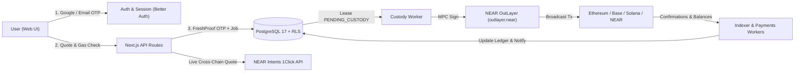
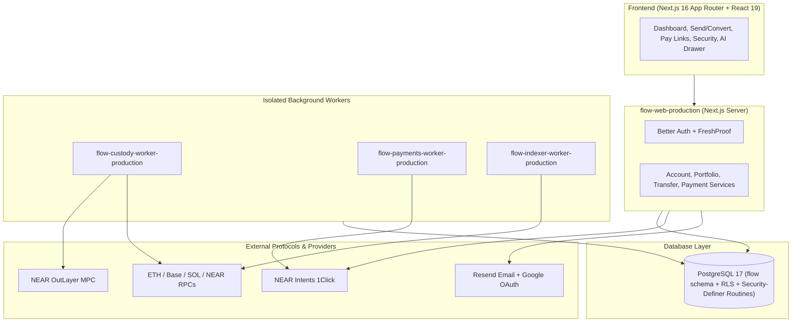

<p align="center">
  
</p>

# FLOW

**Send any asset, on any chain. Receive what you want, where you want.**

FLOW is a chain-abstracted multi-chain payments and custody platform built on **NEAR OutLayer** and **NEAR Intents (1Click)**. Users sign in with Google or an 8-digit passwordless email code, receive a unified multi-chain wallet across **Ethereum**, **Base**, **Solana**, and **NEAR**, and can fund, convert, send, and request payments across chains without juggling bridges, wrapped tokens, or multiple wallet apps.

- **Category:** Chain-Abstracted Multi-Chain Payments & Custody
- **Development Status:** Production Beta (Mainnet Live)
- **Live Application:** [https://flow.devhub.forum](https://flow.devhub.forum)
- **Repository:** [https://github.com/OpeyemiMoses/Flow](https://github.com/OpeyemiMoses/Flow)

---

## Judges Guide

### Project Summary

- **What FLOW does:** Provides a single account and unified multi-chain wallet (`Ethereum`, `Base`, `Solana`, `NEAR`) where the sender chooses the funding asset/network and the recipient receives their chosen settlement asset/network.
- **Problem it solves:** Multi-chain crypto payments are fragmented across incompatible wallets, networks, gas tokens, and manual bridges. Paying someone in USDC on Base when you hold SOL on Solana or NEAR requires multiple apps, swaps, and bridges.
- **Core innovation:** Combines **NEAR OutLayer** (on-chain policy-enforced MPC wallet custody via `outlayer.near`) with **NEAR Intents 1Click** cross-chain quoting/settlement, an isolated background worker architecture (`custody`, `payments`, `indexer`), and **PostgreSQL Row-Level Security (RLS)** so users get a Web2-smooth experience with verifiable on-chain execution.
- **Why it matters:** Makes cross-chain payments feel like a modern payment link—no seed phrases, no manual bridging, automatic verified-email account linking, and built-in gas/balance safety checks.

### Live Demo

- **Public URL:** [https://flow.devhub.forum](https://flow.devhub.forum)
- **Health Endpoint:** [`GET https://flow.devhub.forum/api/health/ready`](https://flow.devhub.forum/api/health/ready)
- **Demo Media Assets:** Rendered explainer assets are stored in [`video-production/`](video-production/).
- **Access Instructions:** Public signup is enabled—click **Sign in**, choose **Continue with Google** or enter any email address for an **8-digit Email OTP**. Signing in with either method using the same verified email automatically links to the same FLOW account.

### How to Evaluate

1. **Sign In & Auto-Provisioning:** Open [https://flow.devhub.forum/sign-in](https://flow.devhub.forum/sign-in) and sign in with Google or Email OTP. Complete onboarding (`/onboarding`) to provision your Personal account and multi-chain OutLayer wallet.
2. **Inspect Multi-Chain Wallet & Balances:** On your dashboard (`/accounts/[id]`), view your unified portfolio, live USD valuation, and permanent deposit addresses for **Ethereum**, **Base**, **Solana**, and **NEAR**.
3. **Add Money / Receive:** Open the **Receive / Add Money** flow to view network-specific deposit QR codes and cross-chain deposit routing via NEAR Intents 1Click.
4. **Live Quote, Gas Check, Send & Convert:** Open **Send** or **Convert**, pick a source asset and destination asset/network, and observe:
   - Real-time 1Click exchange rate, minimum received, and estimated arrival time.
   - Automatic **native gas balance check** (e.g., ETH on Base/Ethereum, SOL on Solana, NEAR on NEAR) before allowing execution.
   - Session-bound **8-digit FreshProof OTP modal** for authorizing outgoing transfers.
5. **Payment Requests (`/pay/[id]`):** Create a payment link/invoice from your account, open the public checkout page `/pay/[id]`, and test cross-chain payer quoting and QR instructions.
6. **AI Assistant & Activity Ledger:** Ask the built-in **FLOW AI Assistant** about your balances, supported routes, or recent activity, and inspect the indexed on-chain activity & ledger summary.

### Key Features to Test

- **Unified Authentication:** Google OAuth + 8-digit Email OTP with automatic verified-email account linking.
- **Multi-Chain OutLayer Custody:** Single wallet deriving permanent addresses on Ethereum, Base, Solana, and NEAR.
- **Cross-Chain Send & Convert:** Live 1Click quotes, automatic balance & native gas checks, and idempotent job execution.
- **Payment Requests:** Shareable `/pay/[id]` checkout links where payers choose any supported source token/chain.
- **Real-Time Indexing & Notifications:** Background workers track deposits, custody broadcasts, 1Click settlement, and push in-app notifications & toasts.

### Technology and Ecosystem Integration

- **NEAR OutLayer (`outlayer.near`):** Policy-governed MPC custody, wallet derivation, on-chain policy sponsorship, and transaction signing.
- **NEAR Intents (1Click SDK `@defuse-protocol/one-click-sdk-typescript`):** Cross-chain token discovery, live quoting, committed deposit routing, and settlement tracking.
- **Chains Supported:** Ethereum Mainnet, Base Mainnet, Solana Mainnet, NEAR Mainnet.
- **Web & Auth:** Next.js 16 (React 19), Tailwind CSS v4, Better Auth 1.7, Resend (transactional OTP email).
- **Data & Workers:** PostgreSQL 17 with Row-Level Security, Prisma 7, and 3 dedicated Railway worker services.

### Onchain Verification

| Network | Asset / Contract | Verification Details |
| :--- | :--- | :--- |
| **NEAR Mainnet** | OutLayer Custody Policy Contract | [`outlayer.near`](https://nearblocks.io/address/outlayer.near) (`store_wallet_policy`) |
| **Base Mainnet** | USDC (`ERC-20`) | [`0x833589fCD6eDb6E08f4c7C32D4f71b54bdA02913`](https://basescan.org/token/0x833589fCD6eDb6E08f4c7C32D4f71b54bdA02913) |
| **Ethereum Mainnet** | USDC / USDT (`ERC-20`) & Native ETH | Verified via RPC balance & tx verification in `src/server/assets/` |
| **Solana Mainnet** | USDC / USDT (`SPL`) & Native SOL | Verified via Solana RPC (`@solana/*` v8) |

Every settled deposit, outgoing transfer, and custody policy sponsorship stores its real on-chain `source_tx_hash` / `destination_tx_hash` and can be verified directly on Etherscan, Basescan, Solscan, or NearBlocks.

### Testing Evidence

Verified against the current codebase:

- **TypeScript (`npx tsc --noEmit`):** Passed with `0` errors.
- **ESLint (`npx eslint`):** `0` errors on modified auth, custody, transfer, and UI files.
- **Unit Test Suite (`npx tsx --test test/*.test.ts`):** **249 / 249 tests passed** (`0` failed, `0` skipped) across 8 suites covering atomic math, custody domain & policy verification, auth environment, 1Click adapter/preview/signature, OutLayer adapter, ledger, activity indexing, payment requests, and portfolio serialization.
- **Live Production Health (`GET https://flow.devhub.forum/api/health/ready`):** Returns HTTP 200 `{"status":"ready"}`.

### Important Notes

- **Mainnet Execution:** Production at `https://flow.devhub.forum` operates on real **Mainnet** networks (`Ethereum`, `Base`, `Solana`, `NEAR`). Sending or converting tokens requires both sufficient token balance and sufficient **native gas** on the source chain (e.g., ETH on Base/Ethereum, SOL on Solana, NEAR on NEAR).
- **Security Proof:** Outgoing transfers (`Send` and `Convert`) require an 8-digit email security code (`FreshProof`) bound to your active session.

---

## Problem Statement

Sending and receiving crypto payments today forces users into a fragmented, error-prone workflow:

1. **Sender-Receiver Chain Mismatch:** A freelancer wants USDC on Base, while the payer holds SOL on Solana or NEAR. Today, the payer must manually bridge, swap, and verify addresses across multiple dApps.
2. **Wallet & Seed Phrase Friction:** Onboarding non-crypto-native users requires explaining seed phrases, RPC networks, and gas tokens before they can even receive a payment.
3. **Silent Gas Failures:** Users holding $100 in USDC on Base or Solana try to send it, only to hit cryptic transaction failures because they hold `0 ETH` or `0 SOL` for gas.
4. **Fragmented Auth:** Signing in with Google vs. Email often creates duplicate accounts or locks users out with `account_not_linked` errors.

---

## The Solution

FLOW abstracts away chains, bridges, and custody complexity behind a clean multi-chain account:

- **One Account, Four Mainnets:** Every user gets deterministic Ethereum/Base, Solana, and NEAR addresses backed by NEAR OutLayer MPC custody.
- **Any-to-Any Payment Routing:** Payers fund in whatever asset/chain they hold; recipients settle in whatever asset/chain they want via NEAR Intents 1Click.
- **Proactive Gas & Balance Guardrails:** Both the UI and backend check spendable balances (accounting for in-flight reserved transfers) and native gas reserves *before* authorizing a transfer.
- **Seamless Auth:** Google OAuth and 8-digit Email OTP automatically link on matching verified emails.

---

## Key Features

- **Passwordless & Social Auth (`src/server/auth/`):** Sign in with Google OAuth or an 8-digit Email OTP (`Resend`), with automatic verified-email linking and session-bound FreshProof verification for sensitive actions.
- **Personal & Business Accounts (`src/server/accounts.ts`):** Create personal wallets or multi-member business accounts with role-based permissions (`OWNER`, `ADMIN`, `MEMBER`) and team invitations.
- **Multi-Chain Portfolio & Indexing (`src/server/assets/`):** Unified balance view across Ethereum, Base, Solana, and NEAR with approximate decimal formatting, token metadata, and on-chain inflow/activity indexing.
- **Cross-Chain Send & Convert (`src/server/outgoing-transfer-service.ts`):** Send to any external address or convert between your own chains/assets with live 1Click quotes, idempotency protection, and native gas validation.
- **Payment Requests & Public Checkout (`src/app/pay/[id]/`):** Generate shareable payment links with QR codes, live payer quotes, and automated settlement tracking.
- **FLOW AI Assistant (`src/app/api/accounts/[id]/ai-assistant/`):** Context-aware assistant for inspecting balances, activity, and payment routes.
- **Real-Time Notifications & Toasts:** In-app notification drawer and toast feedback for deposits, transfers, and account actions.

---

## How It Works

1. **Sign In & Provision:** User authenticates via Google OAuth or 8-digit Email OTP. On first onboarding, FLOW provisions an OutLayer wallet (`flow.wallets`) and records its Ethereum/Base, Solana, and NEAR addresses (`flow.wallet_addresses`).
2. **Fund or Request:** User deposits directly to any of their permanent addresses, uses **Add Money** (1Click cross-chain deposit), or shares a `/pay/[id]` payment link.
3. **Quote & Validate:** When sending or converting, FLOW fetches a 1Click route preview, checks spendable balance minus active reservations, and verifies native gas reserves on the source chain.
4. **Authorize & Execute:** User enters the 8-digit FreshProof OTP in the centered modal, creating an idempotent `PENDING_CUSTODY` job in `flow.outgoing_transfer_jobs`.
5. **Sign, Broadcast & Settle:** The Custody Worker leases the job, signs via OutLayer, broadcasts on-chain, and the Payments/Indexer Workers track confirmation and 1Click settlement into the immutable financial ledger.



---

## System Architecture



- **Frontend Architecture:** Next.js App Router (`src/app/`) with client components (`portfolio-view.tsx`, `checkout-view.tsx`, `controls.tsx`, `sign-in.tsx`) using Tailwind CSS v4 and custom floating navigation.
- **Backend Architecture:** Route handlers in `src/app/api/` delegate to server-only domain services (`src/server/`), validated with Zod `strictObject` schemas and wrapped in transactional PostgreSQL session context (`flow.current_session_token`, `flow.current_account_id`).
- **Database & RLS:** Prisma 7 (`prisma/schema.prisma`) manages the `flow` schema. Application and worker database roles operate under Row-Level Security and least-privilege grants, with `SECURITY DEFINER` routines for worker leasing and atomic ledger transitions.
- **Background Workers:** Three standalone TypeScript worker processes (`scripts/run-custody-worker.ts`, `scripts/run-payment-worker.ts`, `scripts/run-indexer-worker.ts`) handle custody signing, 1Click monitoring, and multi-chain balance/activity indexing.

---

## Technology Stack

| Layer | Technologies | Role |
| :--- | :--- | :--- |
| **Frontend** | Next.js `16.4.5`, React `19.3.1`, Tailwind CSS `4.3.4` | App Router UI, responsive mobile/desktop navigation, modals, and toasts |
| **Backend** | TypeScript `5.9.3`, Node.js `24.22.2`, Zod `4.6.7`, `jose` | API routes, strict input validation, domain logic, and server services |
| **Database** | PostgreSQL `17.11`, Prisma `7.10.1`, `@prisma/adapter-pg` | Relational persistence, RLS policies, migrations, and financial ledger |
| **Authentication** | Better Auth `1.7.18`, Google OAuth, Resend | Passwordless 8-digit Email OTP, Google sign-in, automatic account linking, FreshProof |
| **Blockchain** | NEAR OutLayer, `viem` `2.57.19`, `@solana/*` `8.6.0` | MPC custody, EVM/Solana/NEAR address validation, RPC indexing, and tx verification |
| **Cross-Chain** | `@defuse-protocol/one-click-sdk-typescript` `0.1.26` | Token discovery, live swaps/bridges, deposit quotes, and settlement tracking |
| **Testing & QA** | `tsx`, `playwright` `1.65.0`, ESLint `10`, Prettier `3.9` | Unit tests, DB/RLS integration tests, Playwright security suite, typechecking |
| **Infrastructure** | Railway, Docker Compose | Managed production web, workers, and PostgreSQL; local disposable Postgres |

---

## Integrations and Ecosystem

| Integration | Status | Purpose |
| :--- | :--- | :--- |
| **NEAR OutLayer (`outlayer.near`)** | Active (Mainnet) | MPC wallet provisioning, policy sponsorship, and transaction signing |
| **NEAR Intents (1Click API)** | Active (Mainnet) | Cross-chain asset discovery, quoting, and swap/bridge settlement |
| **Ethereum / Base Mainnets** | Active (Mainnet) | Native ETH and ERC-20 (USDC, USDT) deposits, balances, and transfers |
| **Solana Mainnet** | Active (Mainnet) | Native SOL and SPL (USDC, USDT) deposits, balances, and transfers |
| **NEAR Mainnet** | Active (Mainnet) | Native NEAR and NEP-141 (USDC, USDT) deposits, balances, and transfers |
| **Google OAuth & Resend** | Active (Production) | User authentication, verified email delivery, and security OTPs |

---

## Screenshots and Product Walkthrough

<p align="center">
  
  <br />
  <em>FLOW multi-chain wallet interface across mobile and desktop</em>
</p>

<p align="center">
  
  <br />
  <em>Passwordless 8-digit Email OTP and Google OAuth authentication</em>
</p>

<p align="center">
  
  <br />
  <em>Shareable payment request links with cross-chain QR settlement</em>
</p>

---

## Getting Started

### Prerequisites

- **Node.js** `24.22.2` (pinned in `.node-version`) and **npm** `11.19.1`
- **PostgreSQL** `17.11` (or Docker / Docker Compose using `docker-compose.yml`)
- **Resend API Key** (for Email OTP) and **Google OAuth Web Client** credentials

### Installation

```bash
git clone https://github.com/OpeyemiMoses/Flow.git
cd Flow
npm ci
```

### Environment Configuration

Create your local `.env` from `.env.example` (never commit `.env`):

```bash
(umask 077; cp -n .env.example .env)
```

Core variables in `.env.example`:

| Variable | Description |
| :--- | :--- |
| `FLOW_ENV` | Runtime environment (`local`, `test`, `staging`, `production`) |
| `FLOW_EXECUTION` | Financial execution flag (`disabled` or `enabled`) |
| `FLOW_DATABASE_URL` | PostgreSQL connection string for the least-privilege app role |
| `FLOW_APP_ORIGIN` | Canonical app URL (e.g. `http://127.0.0.1:3000`) |
| `FLOW_AUTH_SECRET` | 32-byte hex secret (`openssl rand -hex 32`) for session cookies |
| `FLOW_OTP_KEY` | 32-byte hex secret (`openssl rand -hex 32`) for OTP hashing |
| `FLOW_GOOGLE_CLIENT_ID` | Google OAuth client ID |
| `FLOW_GOOGLE_CLIENT_SECRET` | Google OAuth client secret |
| `FLOW_MAIL_API_KEY` | Resend API key for transactional OTP emails |
| `FLOW_MAIL_FROM` | Verified sender email address |

### Database Setup

Start disposable PostgreSQL via Docker Compose (see `docker-compose.yml` and `infra/postgres/bootstrap.sql`), then run migrations using a separate migrator role URL:

```bash
export FLOW_MIGRATION_DATABASE_URL="postgresql://flow_local_migrator:<password>@127.0.0.1:55432/flow_local"
npm run db:validate
npm run db:deploy
npm run db:status
```

Verify app database connectivity:

```bash
npm run db:check
```

### Running Locally

```bash
npm run dev
```

The development server runs at `http://127.0.0.1:3000`. Sign-in is at `/sign-in` and health endpoints are at `/api/health/live` and `/api/health/ready`.

To run background workers locally:

```bash
npm run worker:custody
npm run worker:payments
npm run worker:indexer
```

### Production Build

```bash
npm run typecheck
npm run lint
npm run build
npm run start
```

---

## Live Deployment and Infrastructure

FLOW is deployed on **Railway** in the `production` environment (`flow.devhub.forum`):

| Service | Role |
| :--- | :--- |
| `flow-web-production` | Next.js web app & API server serving `https://flow.devhub.forum` |
| `flow-custody-worker-production` | Polls `PENDING_CUSTODY` jobs, signs via OutLayer, and broadcasts transactions |
| `flow-payments-worker-production` | Monitors 1Click cross-chain payment attempts & settlement status |
| `flow-indexer-worker-production` | Indexes mainnet balances and on-chain activity across ETH, Base, SOL, NEAR |
| `Postgres` | Managed PostgreSQL 17 database with private internal networking |

---

## Security and Trust

- **Authentication & Account Linking:** Better Auth with host-only cookies, canonical origin checks, and implicit linking strictly gated to verified Google accounts matching verified emails (`allowDifferentEmails: false`).
- **Session-Bound FreshProof:** Sensitive actions (`transfer-authorize`, `team-change`, security changes) require an 8-digit email OTP bound to the current session ID, purpose, and target UUID.
- **Database Isolation:** Least-privilege DB roles (`app` vs `migrator` vs `worker`), PostgreSQL Row-Level Security (`FORCE ROW LEVEL SECURITY`) driven by transaction-scoped `flow.current_session_token` and `flow.current_account_id`, and `SECURITY DEFINER` routines for worker transitions.
- **Custody & Transfer Safety:** Encrypted custody provider credentials (`AES-256-GCM`), idempotency keys (`(account_id, idempotency_key)`), spendable balance reservation checks, and pre-flight native gas balance enforcement (`INSUFFICIENT_GAS_BALANCE`).
- **Redacted Logging & Rate Limiting:** Structured logs redact secrets/PII, and OTP endpoints enforce client, global, cooldown, and recipient rate limits.

---

## Testing and Verification

| Check | Command | Latest Result |
| :--- | :--- | :--- |
| **TypeScript** | `npx tsc --noEmit` | Passed (`0` errors) |
| **Unit Tests** | `npx tsx --test test/*.test.ts` | **249 / 249 passed** (`0` failed, `0` skipped) |
| **DB / RLS Integration** | `npm run test:db` | Suite in `test/database.integration.ts` (requires migrated `flow_test` DB) |
| **Playwright Security** | `npm run test:security` | Suite in `test/security.integration.mjs` (requires `next build` + `flow_test` DB) |
| **Production Readiness** | `curl https://flow.devhub.forum/api/health/ready` | HTTP 200 `{"status":"ready"}` |

---

## Roadmap

### Completed
- Google OAuth + 8-digit Email OTP authentication with automatic verified-email account linking
- Multi-chain OutLayer wallet provisioning (`Ethereum`, `Base`, `Solana`, `NEAR`) & on-chain policy sponsorship
- Real-time balance & activity indexing across all 4 mainnet networks
- Cross-chain Send & Convert via NEAR Intents 1Click with centered FreshProof OTP modal
- Native gas reserve validation (`checkNetworkGasBalance`) in both UI and backend
- Shareable `/pay/[id]` payment requests & cross-chain checkout
- Built-in FLOW AI Assistant & notification/toast system

### In Progress
- Expanded transaction status notifications and gas-top-up UX prompts

### Planned
- Additional L2 networks and token deployments
- Recurring / scheduled payment requests and team approval workflows

---

## Limitations and Known Issues

- **Mainnet Gas Requirement:** Outgoing transfers on Ethereum, Base, Solana, and NEAR require a small native gas balance on the source chain (`0.0005 ETH` on Ethereum, `0.00001 ETH` on Base, `0.00001 SOL` on Solana, `0.01 NEAR` on NEAR). Gasless/sponsored user transfers for EVM/Solana ERC-20/SPL tokens are not yet enabled.
- **Email Delivery Latency:** Security codes rely on Resend SMTP/API delivery; a 60-second cooldown applies between resends.

---

## API and Developer Documentation

Key API route groups under `src/app/api/`:

- **Health:** `GET /api/health/live`, `GET /api/health/ready`
- **Auth & Security:** `/api/auth/[...action]`, `/api/security/[...action]` (`/api/security/code/start`, `/api/security/code/verify`)
- **User & Onboarding:** `GET /api/me`, `PATCH /api/me/preferences`, `POST /api/onboarding/complete`
- **Accounts & Portfolio:** `/api/accounts/[[...action]]`, `GET /api/accounts/[id]/ledger/summary`, `GET /api/accounts/[id]/notifications`
- **Send, Convert & Add Money:** `POST /api/accounts/[id]/send/quote`, `POST /api/accounts/[id]/send/execute`, `POST /api/accounts/[id]/convert/execute`, `GET /api/accounts/[id]/transfers`, `POST /api/accounts/[id]/add-money`
- **Payment Requests:** `GET /api/pay/[id]`, `POST /api/pay/[id]/quote`, `POST /api/pay/[id]/commit`
- **Discovery & AI:** `GET /api/tokens/discovery`, `POST /api/accounts/[id]/ai-assistant`

---

## Contributing

1. Fork or branch from `main`.
2. Ensure `npm ci` and `npx tsc --noEmit` / `npm run lint` pass before opening a pull request.
3. Never commit `.env*` secrets or bypass RLS / `FreshProof` security boundaries.
4. Add unit or integration tests in `test/` for new domain or API behavior.

---

## License

No `LICENSE` file is currently included in this repository. All rights reserved by the repository authors unless a license is added.

---

## Contact and Community

- **Live App:** [https://flow.devhub.forum](https://flow.devhub.forum)
- **GitHub:** [https://github.com/OpeyemiMoses/Flow](https://github.com/OpeyemiMoses/Flow)
